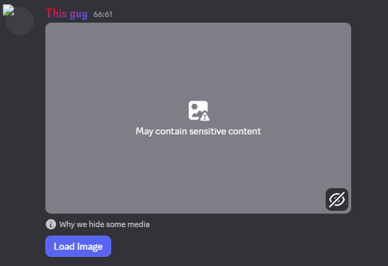
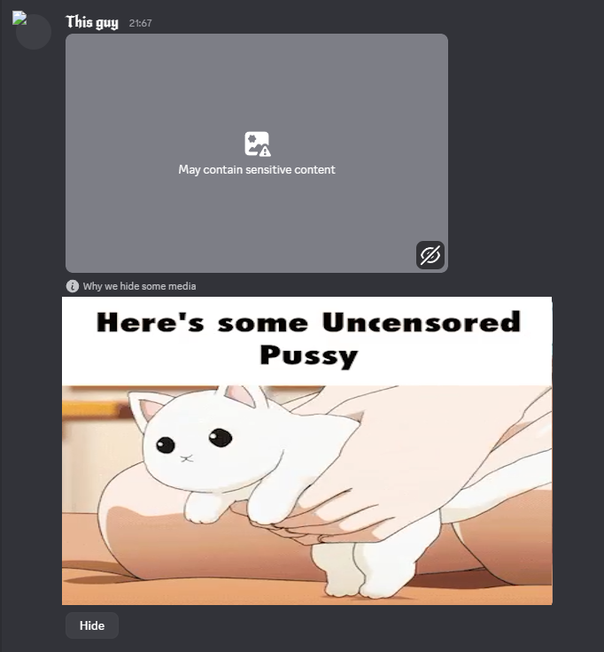

# BypassImageVerify

Vencord plugin that adds a **Load Image** button on messages Discord flags as sensitive media (the "May contain sensitive content" / blocked preview).

Click the button to load the image (or video) from the CDN URL Discord already has on the message. Click again via **Hide** to put it away.

## Screenshots

Before (blocked + button):

After (loaded):

## Install

1. Drop this folder into `src/userplugins/` (or clone it there).
2. Build and inject Vencord as usual.
3. Enable **BypassImageVerify** in Vencord settings.

## Settings

| Setting | Default | What it does |
| --- | --- | --- |
| Auto load | off | Skip the button and load flagged media as soon as the message shows |

## Notes

- Targets embeds/attachments with Discord's explicit/gore media flags.
- Discord's own obscure box may still sit above the plugin UI; the loaded media appears under the button.
- Click a loaded image to open it in Discord's image modal.
